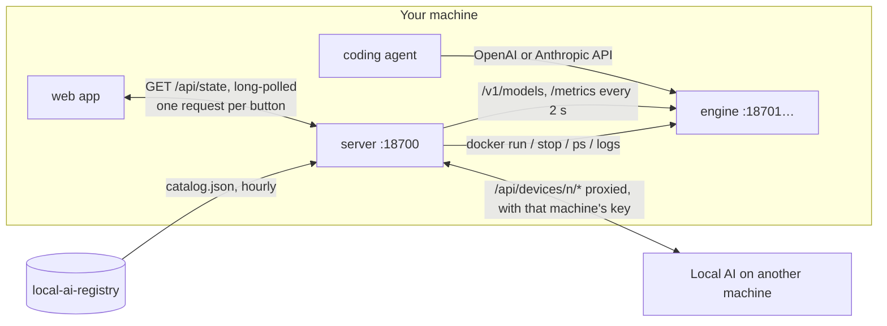

# Local AI

Start a local model with one click, watch it run, and open your coding agent on it.

Local AI is three small pieces:

- **A registry of recipes** ([local-ai-registry](https://github.com/sybil-solutions/local-ai-registry)): for each GPU, which models run on it and the exact `docker run` that starts each one.
- **A server** (`server/`): reads the registry, starts engines in Docker, and reports what the machine is doing.
- **An app** (`web/`): one page the server serves. A narrow window shows the panel, a wide one the desktop layout. Electron (`electron/`) and the Omarchy web app are just windows onto that page.

There is no gateway. Each engine serves its own OpenAI-compatible API on its own port, and agents talk to it directly.

## Run it

```
./install.sh                # a user service that keeps the server running; on Omarchy, also an app-menu entry
node server/index.js        # or just the server: open http://127.0.0.1:18700
npm install && npm start    # or the same page in an Electron window
```

The server needs Node 20 or newer. Starting models also needs Docker and an NVIDIA GPU that `nvidia-smi` can see. The server itself has no dependencies.

A machine that already runs Local AI can install another one on your tailnet: Machines shows the one-line command for it.

| Setting | Default | |
|---|---|---|
| `LOCAL_AI_HOST` | `127.0.0.1` | Address the server and engines bind to. Leave it unset to get loopback plus, when Tailscale is up, this machine's tailnet address. |
| `LOCAL_AI_SHARE` | on | `0` keeps everything on loopback even with Tailscale up. |
| `LOCAL_AI_PORT` | `18700` | The app. Engines take the next 99 ports. |
| `LOCAL_AI_HOME` | `~/.local-ai` | Config, your recipes, usage, events. |
| `LOCAL_AI_MODELS` | `~/.local-ai/models` | Downloaded weights. |
| `LOCAL_AI_REGISTRY` | the registry's `dist/catalog.json` | Where recipes come from. |

## How it works



- **One snapshot.** Every two seconds the server looks at the GPUs (`nvidia-smi`), its containers (`docker ps`), and each engine (`/v1/models`, `/metrics`). The result is one JSON snapshot. The app long-polls it and redraws; nothing else is pushed, and the app keeps no state of its own about the machine.
- **Docker is the record.** A run is a container labelled `local-ai=1` with its recipe, port and GPUs in labels. Restart the server and it adopts whatever is still running.
- **Models it didn't start.** Every 30 seconds it asks each listening port above 1024, over loopback, for `/v1/models`. Whatever answers is shown as running too, with its stats and its address, and is never stopped. The same model id on several ports (an engine and a proxy in front of it) is shown once.
- **Which screen.** The app shows the first screen its rules match for the snapshot (`resolve()` in `web/state.js`): can't connect, needs a key, Docker off, no GPU, downloading, starting, running, failed, and so on. Settings, Models and the rest are ordinary screens opened on top.
- **Your machines.** Machines signed in to your Tailscale account trust each other: one click connects them, and the page opens on any of them without typing the key. Anything else needs the key.

## Files

```
server/
  index.js      HTTP: the web app's files, the route table, the snapshot, start()
  engine.js     runs: start, stop, adopt, watch, find models started elsewhere
  weights.js    Hugging Face downloads and the mounts that put them in a container
  usage.js      tokens served, from each engine's own counters; who is calling
  recipes.js    the registry catalog, your own recipes, the three picks per GPU, model cards
  speed.js      measured tokens per second and load times
  agents.js     coding agents: find, open on a model, install, update
  machines.js   connected machines, your Tailscale machines, key-less pairing
  update.js     the app updating itself from the repo it was cloned from
  util.js       paths, config, events, running commands
web/
  index.html    the page shell
  style.css     every style, in named sections
  app.js        draws the current screen, loads what it needs, does what buttons ask
  state.js      the snapshot, what the page remembers, and resolve()
  screens.js    every screen as a function that returns HTML
  desktop.js    the wide layout: top bar, Home, pages
  ui.js         buttons, rows, icons and the other small pieces
  usage.js      the Usage screen's numbers, chart and calendar
  art.js        the painting and the Background setting
electron/main.js   a window onto the page; starts the server if none is running
install.sh         user service + Omarchy web app
design/            the approved design and the developer handoff (reference only)
```

## Interfaces

### HTTP API

Every route is one line in `ROUTES` in `server/index.js`. All of them need `Authorization: Bearer <key>` except the last four. Errors are `{ "error": "…" }` with a 4xx or 5xx status.

| Route | Does | Handled by |
|---|---|---|
| `GET /api/state?v=` | The snapshot. With the version you already have, waits up to 20 s for a change. | `index.js` `publish` |
| `POST /api/runs` `{ recipe, gpus? }` | Start a recipe: download, pull the engine, run it. | `engine.start` |
| `DELETE /api/runs/:port` | Stop a run, or cancel one that is starting. | `engine.remove` |
| `GET /api/runs/:port/logs?tail=` | The engine's last lines. | `engine.logs` |
| `POST /api/runs/:port/measure` | Measure speed again. | `engine.measureNow` |
| `GET /api/recipe?id=` | A recipe in full, for the editor. | `recipes.raw` |
| `POST /api/recipes` `{ id, … }` | Save a recipe as your own. | `recipes.save` |
| `DELETE /api/recipes?id=` | Drop your changes to a recipe. | `recipes.reset` |
| `POST /api/refresh` | Fetch the registry now. | `recipes.refresh` |
| `GET /api/card?id=` | The model's Hugging Face card, as Markdown. | `recipes.card` |
| `GET /api/usage` | Every day by model, the last two days by hour, live runs. | `usage.detail` |
| `GET /api/endpoints` | Each running model's addresses and APIs, the key, today's callers. | `index.js` `endpoints` |
| `POST /api/open` `{ agent, device, port, folder }` | Open an agent on a running model. | `agents.open` |
| `POST /api/agents` `{ id }` | Install an agent, or update it. | `agents.change` |
| `POST /api/settings` `{ folder?, agent?, home?, background?, picture?, autoUpdate?, hfToken? }` | Save settings. | `index.js` `saveSettings` |
| `GET /api/background` | Your own background picture. | `index.js` |
| `GET /api/tailscale` | Your other Tailscale computers and the command that installs Local AI on one. | `machines.peers` |
| `POST /api/devices` `{ url, key? }` | Connect a machine. No key needed for your own Tailscale machines. | `machines.add` |
| `DELETE /api/devices?i=` | Forget a machine. | `machines.remove` |
| `ANY /api/devices/:i/*` | Any route above, run on a connected machine. | `machines.forward` |
| `POST /api/docker/start` | Start Docker. | `engine.startDocker` |
| `POST /api/app/check`, `POST /api/app/update` | Look for a newer version; install it and restart. | `update.js` |
| `GET /api/health` | `{ ok, app }`. Open to anyone who can reach the port. | |
| `POST /api/pair` | This machine's key. Only for your own Tailscale machines. | `machines.isMine` |
| `GET /install`, `GET /install.tgz` | An installer for another machine. Only for your own Tailscale machines. | `machines.isMine` |

### The snapshot

```
{ v, name,
  docker: { ok, error },
  gpus: [{ index, name, total, used, util, power, temp }],     // memory in MiB
  free: [index],
  groups: [{ card, name, untested, gpus: [index],              // one per kind of GPU; untested names the card it borrows recipes from
             tiers: { fastest, balanced, smartest }, recipes: [Recipe] }],
  runs: [Run],
  usage: { all, days: [{ d, v }] },                            // tokens ever, and per day for the last twelve weeks
  catalog: { at, error, count, id },
  last,                                                        // the recipe started most recently
  devices: [{ i, name, url, online, error, state }],           // state is that machine's own snapshot
  agents: [{ id, name, needs, installed, version, latest, canInstall, job }], agent, folder,
  home: { order, on }, background, picture,
  app: { version, started, latest, notes, phase, error, can, auto },
  hfToken }                                                    // the saved token's last four characters, or null

Recipe = { id, name, local, card, cards, engine, ctx, seqs, vision, think, tools, kv, tps, smart, sizeGb, released, loadS, ready,
           speed: { c1, c4, c8, measured, exact, ttft, at } }
Run    = { id,            // the port it serves on
           recipe, name, url, gpus, since, readyAt, expected,
           phase,         // queued · weights · image · starting · testing · ready · unresponsive · stopping · failed
           detail, progress, error, failure: { word, line }, view: { line, p },
           served, apis: ['chat' | 'responses' | 'messages'], stats: { tps, pps, used, active },
           external,                                           // true for a model Local AI found but did not start
           reachable }                                         // whether another machine can call it
```

### On disk (`~/.local-ai`)

| File | Holds |
|---|---|
| `config.json` | The key, connected machines, default agent and folder, Home layout, background, last recipe. |
| `catalog.json` | The registry as last fetched. |
| `recipes.json` | Your own recipes, by id. They override the registry's. |
| `usage.json` | Tokens per day and per hour, by model. |
| `speeds.json`, `loads.json` | Measured speed and load time per recipe. |
| `events.jsonl` | Everything that happened, one JSON line each. |
| `models/`, `runs/`, `agents/`, `background` | Weights, per-run config files, agent launch scripts and Pi's model list, your picture. |

### Outside the app

| It talks to | For |
|---|---|
| `docker` | `run`, `stop`, `rm`, `ps`, `logs`, `pull`, `image inspect`. Containers carry `local-ai=1` and `local-ai.port`, `.recipe`, `.gpus`, `.since`. |
| `nvidia-smi` | GPUs and their memory. |
| An engine | `GET /v1/models` (is it up), `POST /v1/chat/completions` (one test question, speed), `/v1/responses` and `/v1/messages` (which APIs it has), `GET /metrics` (token counters). |
| `ss` or `lsof` | Listening ports, to find models started elsewhere. |
| `tailscale` | `status --json` (this machine and yours), `whois --json` (who is asking). |
| Hugging Face | Weights, and model cards. The token is read from `HF_TOKEN` or the HF cache's `token` file. |
| npm registry | The newest version of each agent. |
| `git` | The app's own updates, when it was installed from a clone. |

A recipe is the registry's schema: `card`, `model`, `engine`, and a `launch` with `image`, `port`, `args`, `env`, `weights`, `ctx`, `cards`, `seqs`. A registry recipe only runs when its image and weights are pinned and it needs nothing beyond one `docker run`; your own recipes are trusted as written.

## Who can reach what

- The key in `config.json` guards the API. The page gets it written in when opened on the machine itself, or from another machine signed in to your Tailscale account (Tailscale says who is asking, and the request must be addressed to this machine's own tailnet name).
- Engines have no key of their own. Anything that can reach an engine's port can use the model, so keep the server on loopback or a private network such as Tailscale.
- Model cards are other people's Markdown: their tags are stripped, the text is escaped, and only the app's own tags are written, in one pass.

## Working on it

There is no build step and no framework: the server is plain Node, the app is plain ES modules. A screen is a function in `web/screens.js` that returns HTML; a button carries `data-go` (open a screen) or `data-act` (an entry in `ACTS` in `web/app.js`). To add a route, add a line to `ROUTES`.

The design is final and lives in `design/`. `design/handoff/local-ai-build-map.html` maps every screen and how they connect.
