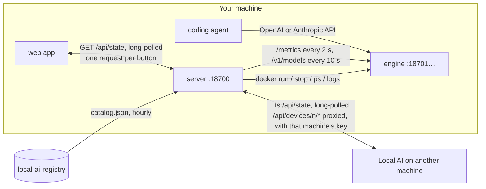

# Local AI

Start a local model with one click, watch it run, and open your coding agent on it.

Local AI is three small pieces:

- **A registry of recipes** ([local-ai-registry](https://github.com/sybil-solutions/local-ai-registry)): for each GPU, which models run on it and the exact `docker run` that starts each one.
- **A server** (`server/`): reads the registry, starts engines (in Docker, or as a pinned program on Apple silicon), and reports what the machine is doing.
- **An app** (`web/`): one page the server serves. A narrow window shows the panel, a wide one the desktop layout. Electron (`electron/`) and the Omarchy web app are just windows onto that page.

There is no gateway. Each engine serves its own OpenAI-compatible API on its own port, and agents talk to it directly.

There is also an iPhone app in `ios/`: it talks to the models your machines are running, and runs LFM3-1.7B on the phone itself. It is built and checked on its own; see [`ios/README.md`](ios/README.md).

## Run it

On a Mac, open `Local-AI-<version>-arm64.dmg` from the repository's Releases and drag Local AI to Applications. It is signed with a Developer ID and notarized by Apple, and brings its own Node.js. On Linux:

```
./install.sh                # a user service that keeps the server running; on Omarchy, also an app-menu entry
node server/index.js        # or just the server: open http://127.0.0.1:18700
npm install && npm start    # or the same page in an Electron window, from source
```

Run from source on a Mac, the Dock and the first word of the menu bar say Electron, because that is the name of the program `npm start` runs. The installed app is Local AI everywhere.

The server needs Node 20 or newer (the Mac app and `install.sh` bring it). Starting models also needs Docker and an NVIDIA GPU that `nvidia-smi` can see, or a Mac with Apple silicon and Python 3.11 or newer (no Docker). The server itself has no dependencies. `install.sh` is for Linux; on a Mac, use the app.

A page opened in a browser asks for the machine's key once (the app's own window, and the Omarchy app-menu entry, are handed it). The key is under Settings › API endpoints, and in `~/.local-ai/config.json`.

A machine that already runs Local AI installs it on another Linux machine on your tailnet: under Machines, choose Set up. It signs in over SSH and sends the app's files over that connection, so the other machine never has to reach this one; where it can't sign in, it shows the one-line command instead. The installer brings its own Node.js when the machine has none.

| Setting | Default | |
|---|---|---|
| `LOCAL_AI_HOST` | `127.0.0.1` | Address the server and engines bind to. Leave it unset to get loopback plus, when Tailscale is up, this machine's tailnet address. |
| `LOCAL_AI_SHARE` | on | `0` stops the app from also answering on the tailnet address when `LOCAL_AI_HOST` is unset. |
| `LOCAL_AI_PORT` | `18700` | The app. Engines take the next 99 ports. |
| `LOCAL_AI_HOME` | `~/.local-ai` | Config, your recipes, usage, events. |
| `LOCAL_AI_MODELS` | `~/.local-ai/models` | Downloaded weights. A recipe that asks for the Hugging Face cache layout uses `HF_HOME/hub` instead. |
| `LOCAL_AI_REGISTRY` | the registry's `dist/catalog.json` | Where recipes come from. |
| `LOCAL_AI_DISCOVER` | on | `0` shows only the models this app started, and stops it looking for ones started elsewhere. |
| `LOCAL_AI_TERMINAL` | the first one installed | `none` opens no terminal: Open always gives the command to paste (a machine nobody sits at). |

## How it works



- **One snapshot.** Every two seconds the server looks at the GPUs, its engines and its containers. The result is one JSON snapshot. The app long-polls it and redraws; nothing else is pushed, and the app keeps no state of its own about the machine.
- **What a look costs.** Looking every two seconds must cost next to nothing, because the machine is there to run models. So nothing is started that can be left running, and nothing is asked twice:
  - `nvidia-smi` is started once and left printing every two seconds (`gpus.js`); started afresh for each reading it was most of the CPU the app used. On Apple silicon, memory is read every six seconds.
  - A working engine gets one request a look: its counters (`/metrics`), which also show it is up. Its model list is asked for every fifth look, or at once when the counters stop answering.
  - Docker is asked what it is running every fifth look, and on every look while a container is on its way up or down or has stopped answering. On Apple silicon, where no run is a container, it is not asked at all.
  - A port that answered and is not a model is not asked again for five minutes.
  - The snapshot is written out once per change, and compressed once per change for other machines (a seventh of the size). A request that changes nothing (any `GET`) does not rebuild it.
  - A connected machine is followed the way its own page follows it: one long-polled request it answers when something changes, so a change there shows here at once and an idle machine costs one request every 20 s.
  - The page's files are kept in memory, compressed, and sent again only when they changed (`ETag`); its scripts are named in the page's head so they are fetched side by side.
  - The page draws when the machine changes and does nothing in between: there is no animation loop, and no redraw while its window is hidden.
  - A connection is kept for five minutes after its last request. A press on a connected machine's page then costs one trip to that machine, not the two or more it takes to open a connection first.
  - A model card is kept for a day, and a model that has none is not asked about again for ten minutes.
  - A speed measurement and the first test question put no limit on the answer's length; the engine ends them itself.
- **Docker is the record.** A run is a container labelled `local-ai=1` with its recipe, port and GPUs in labels. Restart the server and it adopts whatever is still running.
- **Apple silicon.** The chip is one GPU whose memory is the unified RAM, and it only runs recipes made for exactly that chip (`backend: metal`). Such a recipe is `kind: host`: a `command` that is Python and the recipe's own script (never `-c`, `-m` or another file), `pip` packages each pinned with `==`, the script in `config` with a `sha256` that must match, and weights pinned to a commit. Because it runs as you rather than in a container, the app shows what it will run and waits for Allow the first time, and again whenever the recipe changes. The engine is given a short environment (`PATH`, `HOME`, the locale, what the recipe sets), not the app's. Each recipe's packages get their own venv in `envs/`, shared by recipes that pin the same ones and deleted after 30 unused days. The engine runs in `runs/<port>/` on an inner port (the app's port + 100 and up); the server listens on the run's own port in front of it and counts the tokens each answer reports (`meter.js`), since such engines have no `/metrics`. The engine outlives the app like a container does: `hosts.json` remembers it, and a restarted app adopts it again only if the process still runs in that folder and started when it did. Quitting the app closes the front port until the app is back.
- **Models it didn't start.** Every 30 seconds it asks each listening port above 1024, over loopback, for `/v1/models`. Whatever answers with one model, or with several and engine counters on `/metrics` (vLLM, SGLang, llama.cpp), is shown as running too, with its stats and its address, and is never stopped. A proxy that lists several models and has no engine counters (a gateway to cloud APIs) is not. The same model id on several ports (an engine and a proxy in front of it) is shown once.
- **A model is counted on the machine it runs on.** A port on this machine that only passes requests on to a model on a connected machine (an SSH tunnel, a forwarder) answers exactly like that model, counters and all. It is that machine's model: it is not shown as running here, and its tokens are not this machine's usage. Each machine puts in its snapshot when each of its engines started (`born`), so the same engine reached through a port here is recognised without asking the other machine anything; anything it was counted for before that is taken back. Usage shows one machine's own tokens, and says whose. The one total across machines is under "All machines" on the Usage page, labelled as added up, machine by machine.
- **Which screen.** The app shows the first screen its rules match for the snapshot (`resolve()` in `web/state.js`): can't connect, needs a key, Docker off, no GPU, downloading, starting, running, failed, and so on. Settings, Models and the rest are ordinary screens opened on top.
- **Your machines.** Machines signed in to your Tailscale account trust each other: one click connects them, and the page opens on any of them without typing the key. Anything else needs the key.

## Files

```
server/
  index.js      HTTP: the route table, who holds the key, settings, start()
  snapshot.js   the snapshot: built on a change, long-polled, compressed for other machines; what agents can be pointed at
  static.js     the page's files: kept in memory, compressed, sent again only when changed
  engine.js     runs: start, stop, logs, and the look every two seconds
  runs.js       the runs themselves and what the others share: status, changes, failures, free GPUs
  health.js     whether an engine answers, its first reply, its APIs, when to measure it
  containers.js a run as a Docker container: launch, stop, logs, adopt what is already running
  hosts.js      a run as a program on this machine (Apple silicon): venv, launch, stop, adopt
  discovery.js  models started elsewhere on this machine, found by asking listening ports
  docker.js     the one `docker run` a recipe becomes, and which of its options are allowed
  gpus.js       the GPUs: nvidia-smi left running, the Apple chip, a GPU that shares the system's memory
  weights.js    Hugging Face downloads and the mounts that put them in a container
  meter.js      the front port of a host run: passes requests to the engine and counts their tokens
  usage.js      tokens served, from each engine's own counters; who is calling
  recipes.js    the registry catalog, your own recipes, the three picks per GPU, model cards
  speed.js      measured tokens per second and load times
  agents.js     coding agents: find, open on a model, install, update
  shell.js      the person's own shell: its PATH, running a command in it, launch scripts
  terminals.js  the terminals installed here and opening one on a script
  pi.js         Pi and Oh My Pi: the extension that registers each running model as a provider
  apps.js       desktop apps that are opened, not run in a terminal: T3 Code, DeepSeek Harness
  dsh.js        DeepSeek Harness: writes the running models into its settings, as text
  machines.js   connected machines (each followed by long-poll), your Tailscale machines, key-less pairing, installing on one
  update.js     the app updating itself from the repo it was cloned from
  util.js       paths, config, events, running commands
web/
  index.html    the page shell
  style.css     every style, in named sections
  app.js        starts the page: listens for presses and typing, follows the snapshot, redraws
  state.js      the snapshot, what the page remembers, and resolve()
  screens.js    every screen, as an arrangement of components
  desktop.js    the wide layout: top bar, Home, pages
  view.js       draws a screen into the page and fits the window to it
  actions.js    what buttons do (ACTS) and what screens fetch (LOAD)
  html.js       the `html` tag every piece of markup is written with; it escapes what is put into it
  markdown.js   a model card's Markdown as the app's own few tags
  format.js     how numbers, sizes and times are written
  art.js        the picture behind everything and the Background setting
  components/   the reusable pieces: icons, controls (buttons, switches, fields), layout (bars, rows, tables),
                home (title, stats, GPUs), models, agents, usage
electron/main.js   a window onto the page; starts the server if none is running; fits the window to the panel when the page shows it (preload.cjs)
electron/          also the Mac build's entitlements and before-pack.cjs, which puts a readable copy of the app in the bundle for installing on other machines
install.sh         user service + Omarchy web app
ios/               the iPhone app (Swift); its own README
tests/             e2e.mjs (the real desktop app, driven through its window), integration.mjs (the real server against
                   stand-in engines, Docker and a second machine), screens.mjs (every screen drawn), fuzz.mjs (hostile
                   input), and stand-ins/ (an engine, a Docker and an nvidia-smi that answer like real ones)
scripts/           release-mac.sh (the signed, notarized DMG)
design/            the approved design and the developer handoff (reference only)
```

## Interfaces

### HTTP API

Every route is one line in `ROUTES` in `server/index.js`. All of them need `Authorization: Bearer <key>` except the last four. Errors are `{ "error": "…" }` with a 4xx or 5xx status.

| Route | Does | Handled by |
|---|---|---|
| `GET /api/state?v=` | The snapshot. With the version you already have, waits up to 20 s for a change. Compressed for a caller on another machine that accepts gzip. | `snapshot.js` `answer` |
| `POST /api/runs` `{ recipe, gpus?, approve? }` | Start a recipe: download, pull the engine, run it. A host recipe not yet allowed answers 409 until `approve` is the fingerprint in its `approve` field. | `recipes.allowed`, `engine.start` |
| `DELETE /api/runs/:port` | Stop a run, or cancel one that is starting. | `engine.remove` |
| `GET /api/runs/:port/logs?tail=` | The engine's last lines. | `engine.logs` |
| `POST /api/runs/:port/measure` | Measure speed again. | `engine.measureNow` |
| `GET /api/recipe?id=` | A recipe in full, for the editor. | `recipes.raw` |
| `POST /api/recipes` `{ id, … }` | Save a recipe as your own. | `recipes.save` |
| `DELETE /api/recipes?id=` | Drop your changes to a recipe. | `recipes.reset` |
| `POST /api/refresh` | Fetch the registry now. | `recipes.refresh` |
| `GET /api/card?id=` | The model's Hugging Face card, as Markdown. | `recipes.card` |
| `GET /api/usage` | Every day by model, the last two days by hour, live runs. | `usage.detail` |
| `GET /api/endpoints` | Each running model's addresses and APIs, the key, today's callers. | `index.js` `endpoints` |
| `POST /api/open` `{ agent, device, port, folder }` | Open an agent on a running model. | `agents.open` |
| `POST /api/agents` `{ id }` | Install an agent, or update it. | `agents.change` |
| `POST /api/settings` `{ folder?, agent?, terminal?, home?, background?, picture?, autoUpdate?, hfToken? }` | Save settings. | `index.js` `saveSettings` |
| `GET /api/background` | Your own background picture. | `index.js` |
| `GET /api/tailscale` | Your other Tailscale computers and the command that installs Local AI on one. | `machines.peers` |
| `POST /api/tailscale/install` `{ ip, update? }` | Install Local AI on one of your Tailscale machines, over SSH from this one. A copy that updates itself is never touched, and one already running is replaced only with `update`. | `machines.install` |
| `POST /api/devices` `{ url, key? }` | Connect a machine. No key needed for your own Tailscale machines. | `machines.add` |
| `DELETE /api/devices?i=` | Forget a machine. | `machines.remove` |
| `ANY /api/devices/:i/*` | Any route above, run on a connected machine. | `machines.forward` |
| `POST /api/docker/start` | Start Docker. | `engine.startDocker` |
| `POST /api/app/check`, `POST /api/app/update` | Look for a newer version; install it and restart. | `update.js` |
| `GET /api/health?nonce=` | `{ ok, app }`. Open to anyone who can reach the port. With a hex nonce also `proof`, an HMAC of it under the key: how the desktop app knows a server already on the port is this user's before using it. | |
| `POST /api/pair` | This machine's key. Only for your own Tailscale machines. | `machines.isMine` |
| `GET /install`, `GET /install.tgz` | An installer for another machine. Only for your own Tailscale machines. | `machines.isMine` |

### The snapshot

```
{ v, name,
  docker: { ok, error }, needsDocker,                          // needsDocker is false when every GPU is Apple silicon
  gpus: [{ index, name, total, used, util, power, temp, unified }],  // memory in MiB; unified for Apple silicon
  free: [index],
  groups: [{ card, name, untested, gpus: [index],              // one per kind of GPU; untested names the card it borrows recipes from
             tiers: { fastest, balanced, smartest }, recipes: [Recipe] }],
  runs: [Run],
  usage: { all, days: [{ d, v }] },                            // tokens ever, and per day for the last 84 days that had any
  catalog: { at, error, count, id },
  last,                                                        // the recipe started most recently
  devices: [{ i, name, url, online, error, state }],           // state is that machine's own snapshot
  agents: [{ id, name, needs, installed, version, latest, canInstall, canUpdate, app, job }], agent, folder,
  terminals: [{ id, name }], terminal,                         // terminals installed here, and the one Open uses
  home: { order, on } | null, background, tone, picture,       // background: clouds · fresco · own · none; tone: gray · color, or null for the default
  app: { version, started, latest, notes, phase, error, can, auto },
  hfToken }                                                    // the saved token's last four characters, or null

Recipe = { id, name, local, host, approve,                    // approve: what to send to allow a host recipe, or null when there is nothing to allow
           card, cards, engine, ctx, seqs, vision, think, tools, kv, tps, smart, sizeGb, released, loadS, ready,
           speed: { c1, c4, c8, measured, exact, ttft, at } }
Run    = { id,            // the port it serves on
           host,          // true when it runs as a program on this machine, not in a container
           recipe, name, url, gpus, since, readyAt, expected,
           phase,         // queued · weights · image · starting · testing · ready · unresponsive · stopping · failed
           detail, progress, error, failure: { word, line }, view: { line, p, word? },   // word only when it failed
           ctx, vision,
           served, apis: ['chat' | 'responses' | 'messages'], stats: { tps, pps, ppsEst, used, active },   // pps: prefill speed; ppsEst: it is an estimate, see below
           external,                                           // true for a model Local AI found but did not start
           born,                                               // when the engine's process started, where it says: the same engine, however it is reached
           reachable }                                         // whether another machine can call it
```

### On disk (`~/.local-ai`)

| File | Holds |
|---|---|
| `config.json` | The key, connected machines, default agent and folder, Home layout, background, last recipe, the host recipes you allowed. |
| `catalog.json` | The registry as last fetched. |
| `recipes.json` | Your own recipes, by id. They override the registry's. |
| `usage.json` | Tokens per day and per hour, by model. |
| `speeds.json`, `loads.json` | Measured speed and load time per recipe. |
| `events.jsonl` | Everything that happened, one JSON line each. |
| `models/`, `runs/`, `agents/`, `background` | Weights, per-run config files (for a host run also its script, weight links and `engine.log`, rotated at 20 MB), agent launch scripts, the running models as a list (`agents/models.json`) and the Pi extension that reads it (`agents/local-ai.js`), your picture. |
| `hosts.json`, `envs/` | Host runs that are running (pid, inner port, start time), and their Python venvs. |

### Outside the app

| It talks to | For |
|---|---|
| `docker` | `run`, `stop`, `rm`, `ps`, `logs`, `pull`, `image inspect`. Containers carry `local-ai=1` and `local-ai.port`, `.recipe`, `.gpus`, `.since`, `.reach`. Every option of `docker run` is written as one word (`--name=…`), so no value can pass for another option. |
| `nvidia-smi` | GPUs and their memory, from one `nvidia-smi -l 2` left running. On Apple silicon `sysctl` and `vm_stat` instead. A GPU that shares the system's memory (DGX Spark) reports none, so its memory is read from `/proc/meminfo` and it is marked `shared`. |
| `python3`, `pip` | On Apple silicon: a venv per host recipe and its pinned packages. `ps` and `lsof` check a remembered engine before it is adopted. |
| An engine | `GET /v1/models` (is it up), `POST /v1/chat/completions` (one test question, speed; neither with a limit on the answer), `/v1/responses` and `/v1/messages` (which APIs it has), `GET /metrics` (token counters). Decode speed is generated tokens over the 2 s between reads. Prefill speed is the tokens the engine computed while prefilling over the time the engine says that took: vLLM's histograms, llama.cpp's own gauge, or the `timings` a host engine reports in its answers. Where the engine reports no such timing the number is an estimate, shown as "Prefill tok/s (est.)": for a host engine (mlx_lm.server), uncached prompt tokens over the wait for the first streamed token, which also holds queueing and the first decode step; for the rest, prompt tokens that missed the cache over the window. The two are never mixed. Prefills under 1,000 tokens are left out, since they time the engine's overhead more than its speed, and the number shown is the average over the last five minutes of prefills, so it stays between prompts. Until the app has seen a prefill it shows the engine's lifetime average, never 0. Prompt tokens served from the prefix cache are not prefill. |
| `ss` or `lsof` | Listening ports, to find models started elsewhere. |
| `tailscale` | `status --json` (this machine and yours), `whois --json` (who is asking). |
| Hugging Face | Weights, and model cards. The token is read from `HF_TOKEN` or the HF cache's `token` file. |
| npm registry | The newest version of each agent. |
| An agent | Opened in a terminal with its own config folder, so it stays signed in: the model is passed in environment variables or flags for that run only. Pi and Oh My Pi get it from an extension (`-e agents/local-ai.js`) that registers each running model as a provider. On a Mac the terminal is the first installed of Ghostty, iTerm, kitty, WezTerm, Alacritty, Terminal, or the one chosen under Agents; Warp can't be started on a script. |
| T3 Code | A desktop app that runs Pi itself and keeps a model for every thread. Open places the same extension in Pi's `extensions/` folder (once), then starts a thread on the model by its exact name: `t3 thread start <folder> … --provider pi --model la-<machine>-<port>/<model>` (the folder is added as a project first if T3 Code has not seen it). Nothing is left to "Pi default". A thread has to begin with a message, so it begins by asking the model to say it is ready; the answer shows the thread is on the model. Then `t3 app <folder>` brings the app forward. |
| DeepSeek Harness | A desktop app with its own model list (`~/.dsh/profiles/web/cordis.patch.yml`, reloaded as it changes) and key store. Open writes the running models into that list, each as a provider named as Pi's are (`la-<machine>-<port>`), makes the one opened the model new conversations start on, and adds one key name (`LOCAL_AI_API_KEY`) to `~/.dsh/.credentials.yaml`, since the Harness asks every provider for a key. Only those three places are edited, as text; your own providers and keys are left byte for byte (`server/dsh.js`), and the settings as they were are kept in `cordis.patch.yml.before-local-ai`. Models that are no longer running are taken out again the next time you open it from here. |
| `ssh` | Installing Local AI on one of your own Tailscale machines when you ask: it signs in as you would (the machine's name, its tailnet name, its address) and runs the installer this machine serves. |
| `git` | The app's own updates, when it was installed from a clone. |

A recipe is the registry's schema: `card`, `model`, `engine`, and a `launch` with `image`, `port`, `args`, `env`, `weights`, `ctx`, `cards`, `seqs` (a host recipe has `kind: host`, `backend`, `command`, `pip` and `config` instead of `image` and `args`). A registry recipe only runs when its image and weights are pinned and it needs nothing beyond one `docker run`, or for a host recipe, when everything above is pinned; your own recipes are trusted as written. Host recipes can't be edited in the app yet.

## Who can reach what

What the app defends, and against whom:

- **The key.** The key in `config.json` (readable only by you) guards the whole API, and holding it means being able to start models. It is never given to a caller just for being on this machine: another user's program, or anything that forwards connections here, asks from loopback too. The desktop app reads the file and hands the key to its own window in the address (`#key=…`, removed at once); the installer does the same for the app-menu entry; a browser asks for it once. A server already on the port must prove it holds your key (an HMAC of a random nonce) before the app shows it or hands it anything.
- **Your machines.** Another machine signed in to your Tailscale account as you is given the key without typing it: Tailscale says who is asking, and the request must be addressed to this machine's own tailnet name or address, so a rebound DNS name can't borrow that. Tagged machines (which all share one stand-in owner) and this machine's own tailnet address don't count.
- **Other websites.** Everything is served with a content policy that runs only the app's own scripts and can't be framed. A page on another site can't read the API (no CORS), and can't use a model either: a host run's port answers only to this machine's own address, and refuses a request that says it comes from another site's page.
- **The registry.** A registry recipe is data from the network. A container recipe runs only when its image and weights are pinned by hash, and it can add only a short list of Docker options, each with one plain value; the container can't gain privileges, publishes one port, and mounts only the app's own folders, read-only. A host recipe runs as you, so it must be its own hashed script, pinned, and it waits for you to allow it (above). Your own recipes are trusted as written.
- **Connected machines.** What another machine sends is held to the shape the app reads and cut to size before it is kept; none of it can become markup (`web/html.js` escapes everything), and a machine that sends something unreadable is left for this one.
- **Model cards** are other people's Markdown: their tags are dropped, the text is escaped, and only the app's own few tags are written, in one pass that stays fast on any input.
- **The desktop app** is sandboxed with context isolation, navigates nowhere but its own page, opens only web links (in your browser), grants no permission but fullscreen and copying, and can't be started as plain Node or with a debugger attached (Electron fuses).

What it does not defend: an engine in a container has no key and no such door, so anything that can reach its port can use the model (keep the server on loopback or a private network such as Tailscale); any program of yours that answers like an OpenAI server on loopback is shown as a model; updates and the registry are fetched over HTTPS, not signed.

## Working on it

```
npm ci && npm run check                    # everything below, in order
npm run lint                               # mistakes that break at runtime: undefined names, leftovers
npm run screens                            # every screen drawn for every state, with hostile text in every field
npm run fuzz                               # hostile input against everything that decides what is safe
npm run test:integration                   # the real server against stand-in engines, Docker and a second machine
npm run test:e2e                           # the real desktop app, driven through its window
npm run release:mac                        # the signed, notarized DMG (needs a Developer ID and a notarytool profile)
```

**Tests.** There are no unit tests, on purpose: a function that passes alone says little about an app whose work is other programs. Two kinds of test run the real thing and check what a user would notice.

- **Integration** (`tests/integration.mjs`) starts the real server against a fixture registry and stand-ins that answer like the real ones: an engine (`fake_engine.py`), a `docker` and an `nvidia-smi` on `PATH`, and a second Local AI as another machine. It starts, stops and adopts models, reads usage and speed, pairs and follows the second machine, and checks the costs above (how often Docker is asked, that `nvidia-smi` is started once, that an unchanged file is not sent twice). It also checks that a model on the second machine, reached through a port here, is counted there and not here. On Apple silicon it also starts a pinned host recipe in its own venv.
- **End to end** (`tests/e2e.mjs`) starts the desktop app itself (Electron, with its own data folder) and drives its window over the Chrome DevTools Protocol, as a person would: pick a model, start it, open an agent on it, read usage, edit a recipe, rearrange Home, change the background, connect a second machine, stop. It fails on any error the page logs, and on a page that keeps working when nothing is happening.
- The stand-in engines say what they are (`owned_by: local-ai-tests`), and only a copy under test (`LOCAL_AI_STAND_INS=1`) shows them. Running the tests on a machine never puts a test model on the Home, or its tokens in the usage, of the copy you use there.

Beside them, `tests/screens.mjs` draws every screen in both layouts for every state the server can report (460 renders) and fails if one throws or if any text it was given comes out as markup. `tests/fuzz.mjs` goes after the parts that decide what is safe: every short string of troublemaking characters against the Docker option grammar (exhaustively), random hostile recipes whose `docker run` is read back the way Docker reads it, file names in a download listing, model cards (for markup and for time), what a connected machine may send, the door on a model's port, host recipes, DeepSeek Harness settings, and the running server's paths and API. It is seeded, so a finding can be repeated: `node tests/fuzz.mjs <seed>`.

CI (`.github/workflows/`) runs all of it on Linux on every push and pull request (the end-to-end test under `xvfb`), the integration and end-to-end tests on macOS when `server/`, `electron/` or `tests/` change (macOS minutes cost ten times as much), and `npm audit` weekly and when the lockfile changes. Dependabot opens one grouped update a week for npm and one for the actions, which are pinned by commit.

`npm run release:mac` builds `dist/Local-AI-<version>-arm64.dmg`: the app is signed with the Developer ID in the keychain under the hardened runtime, notarized, and stapled; then the DMG itself is signed, notarized and stapled, and Gatekeeper is asked whether it would open both. Set `APPLE_KEYCHAIN_PROFILE` to a profile saved with `xcrun notarytool store-credentials`.

There is no build step and no framework: the server is plain Node, the app is plain ES modules. A screen is a function in `web/screens.js` that arranges components from `web/components/`; a component is a function that returns markup written with the `html` tag, which escapes everything put into it, so text the page is told can never become markup. A button carries `data-go` (open a screen) or `data-act` (an entry in `ACTS` in `web/actions.js`). To add a route, add a line to `ROUTES`.

The design is final and lives in `design/`. `design/handoff/local-ai-build-map.html` maps every screen and how they connect.
